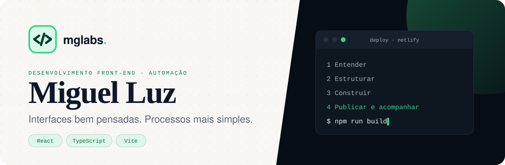

<p align="center">
  
</p>

<p align="center">
  
  
  
  
</p>

# Portfólio — Miguel Luz

Portfólio de desenvolvedor front-end com os projetos, a experiência e o processo de trabalho da **MGLabs**.

- **Stack:** React 19, TypeScript e Vite, com CSS nativo e design tokens.
- **Sem JavaScript também funciona:** o HTML é pré-renderizado no build.
- **Imagens otimizadas:** WebP responsivo gerado por script.
- **Deploy:** Netlify.

## Rodando localmente

```bash
npm install
npm run dev       # desenvolvimento em http://localhost:5173
npm run build     # typecheck + build + pré-renderização em dist/
npm run preview   # serve o dist/ em http://localhost:4173
npm run images    # regenera as imagens WebP responsivas
```

Na Netlify: comando `npm run build`, pasta de publicação `dist`.

## Onde editar

| O quê | Arquivo |
| --- | --- |
| Nome, links, hero, etapas do processo, currículo | `src/content/site.ts` |
| Projetos (HM2, Moraes Luz, monitoramento, MGLabs) | `src/content/projects.ts` |
| Experiência, conhecimentos, formação | `src/content/experience.ts` |
| Cores, fontes, espaçamentos, curvas de animação | `src/styles/tokens.css` |

<details>
<summary><strong>Guias rápidos</strong></summary>

### Currículo
Coloque o PDF em `public/` e troque `resumeUrl = null` por `"/nome-do-arquivo.pdf"` em `src/content/site.ts`.
Enquanto for `null`, os botões oferecem "solicitar por e-mail".

### Novo projeto com screenshots
1. Coloque as imagens originais em `images-src/`.
2. Registre-as em `SOURCES` dentro de `scripts/optimize-images.mjs` e rode `npm run images`.
3. Adicione um objeto em `featuredProjects` (`src/content/projects.ts`) usando os nomes registrados.

### Status do projeto de monitoramento
Em `monitorProject.features`, troque `state` entre `"planejado"`, `"implementado"` e `"validado"`.

</details>

## Estrutura

```
src/
  content/        textos e dados (edite aqui)
  styles/         tokens.css (design tokens) e base.css (reset, tipografia, animações de entrada)
  hooks/          observadores de scroll, ciclo das demos, tilt, media queries
  components/
    ui/           Window, Stepper, Tag, Button, Words, ResponsiveImage, SectionHeader, Icon
    hero/         Hero + HeroDemo (briefing → estrutura → conteúdo → publicado)
    projects/     ProjectCase, MonitorCase + PublicationsDemo, Projects
    experience/   Experience + ContractsDemo
    Nav, Process, Skills, About, Contact
scripts/          optimize-images.mjs, prerender.mjs
images-src/       originais grandes (fora do build)
```

## Contato

[LinkedIn](https://www.linkedin.com/in/miguelluz19) · [GitHub](https://github.com/mgluz1) · [MGLabs](https://mglabss.netlify.app/) · miguelmluz777@gmail.com
